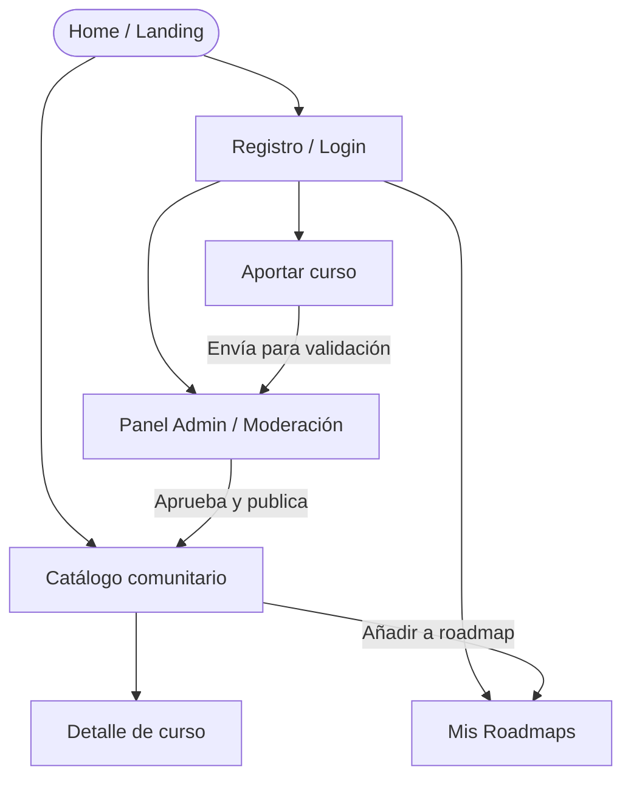

# APPFlow — Mapa del sitio y flujos de usuario — CommunityCoursesIT

> **Qué es:** el esqueleto de navegación. Sitemap (todas las pantallas y sus rutas), ficha por
> pantalla y flujos de usuario extremo a extremo. Es el puente entre el PRD (qué quiere el usuario)
> y el BackendSchema (qué API lo sostiene).
> **Cuándo está bien:** se puede recorrer el producto entero en papel antes de escribir una línea
> de React; cada pantalla sabe qué API consume, y esas APIs existen en el BackendSchema;
> no hay ninguna pantalla "colgada" sin ruta ni ningún flujo sin pantallas.

## 1. Sitemap

## 2. Rutas

| Ruta | Pantalla | Requiere login | Notas |
|------|----------|----------------|-------|
| `/` | Home | no | Landing page con propuesta de valor y cursos destacados. |
| `/catalogo` | Catálogo comunitario (paginado) | no | Listado paginado con búsqueda y filtros cruzados. |
| `/catalogo/:id` | Detalle de curso | no | Muestra temario, reseñas y CTA para agregar al roadmap.|
| `/roadmap` | Mi roadmap | sí | Dashboard para gestionar rutas de aprendizaje |
| `/aportar` | Formulario de aporte | sí | Carga de nuevos cursos sugeridos a la comunidad. |
| `/admin` | Panel de validación | sí (Rol Admin) | Moderación de aportes en estado "en revisión" |
| `/login`, `/registro` | Autenticación | no | Formularios de acceso. Guardan URL previa para redirect. |

## 3. Fichas de pantalla

> Una por cada pantalla del sitemap.

### Pantalla: Catálogo comunitario (`/catalogo`)

- **Objetivo del usuario:** Buscar y filtrar cursos gratuitos relevantes para su formación.
- **Componentes (de la UX-UI):** header, filtros/búsqueda, grid de cards, paginador, empty state, skeleton
- **Estados:** `loading` (skeleton) · `ok` · `empty` (sin resultados) · `error` (retry)
- **APIs que consume:** `GGET /api/v1/courses?page=…&limit=20&category=…&q=…` 
- **Navegación:** Accesible desde el menú principal; dirige a Detalle de curso al hacer clic en una card.

### Pantalla: Detalle de curso (`/catalogo/:id`)

- **Objetivo del usuario:** Evaluar el contenido del curso y agregarlo a su roadmap personal.
- **Componentes (de la UX-UI):** Breadcrumbs, cabecera con metadatos, panel del aportante, acordeón de módulos, floating action bar con CTA "Agregar a mi roadmap".
- **Estados:** `loading` · `ok` · `not found` (404 personalizado si el ID no existe)
- **APIs que consume:** `GET /api/v1/courses/:id · POST /api/v1/roadmaps/active/courses` (al añadir)
- **Navegación:** `/catalogo`; acción de añadir redirige a `/login` si el usuario es anónimo.

### Pantalla: Aportar curso (`/aportar`)

- **Objetivo del usuario:** Sugerir un curso gratuito aportando su URL, metadatos y revisión.
- **Componentes (de la UX-UI):** Formulario principal, input con debounce para verificación de URL, radio buttons para declaración de completitud
- **Estados:** `idle` · `validating_url` · `submitting`(spinner) · `success` (toast confirmación).
- **APIs que consume:** `GET /api/v1/courses/check-url?url=… · POST /api/v1/submissions`
- **Navegación:** Desde menú autenticado; redirige a una vista de "estado de mis aportes" o limpia el formulario tras el éxito.

### Pantalla: Mi roadmap (`/roadmap`)

- **Objetivo del usuario:** Visualizar, reordenar y configurar la visibilidad de su ruta de aprendizaje.
- **Componentes (de la UX-UI):** Selector de roadmaps (pills), toggle switch de privacidad (Público/Privado), lista drag & drop de cursos, barra de progreso.
- **Estados:** `loading` · `ok` · `empty`(CTA para explorar catálogo)
- **APIs que consume:** `GET /api/v1/roadmaps/me · PATCH /api/v1/roadmaps/:id/visibility · PUT /api/v1/roadmaps/:id/reorder`
- **Navegación:** Desde el avatar/menú de usuario.

### Pantalla: Panel Admin (`/admin`)

- **Objetivo del usuario:** Revisar cursos sugeridos para aprobarlos o rechazarlos garantizando calidad.
- **Componentes (de la UX-UI):** Tabs (Pendientes, Aprobados, Rechazados), cards detalladas del aporte, modal de rechazo tipificado
- **Estados:** `loading` · `ok` · `empty`(cero tareas pendientes)
- **APIs que consume:** `GET /api/v1/submissions?status=pending` · `POST /api/v1/submissions/:id/approve` · `OST /api/v1/submissions/:id/reject`
- **Navegación:** Accesible únicamente si el JWT contiene el rol "ADMIN".

## 4. Flujos de usuario (mínimo 3)

> Pasos numerados de punta a punta, incluyendo validaciones, errores y ramas alternativas.

### Flujo 1 — Aportar un curso al catálogo

1. Usuario logueado presiona "Aportar curso" (menú/header)
2. Llega a `/aportar`; el formulario pide: URL activa, categoría (lista), tema, título, versión, año, docentes, flags (cuestionarios / examen / certificado / aval), y la declaración "yo tomé este curso"
3. Validaciones en línea: [campos obligatorios, formato de URL, duplicado]
4. Submit → `POST /api/v1/aportes` → 201 con estado `en_revision`
5. Toast de confirmación + redirección a "estado de mi aporte"
6. **Rama de error:** validación fallida → mensajes inline, nada se pierde; error de red → toast de error + reintentar

### Flujo 2 — Descubrir un curso y agregarlo a mi roadmap

1. Visitante no autenticado navega por `/catalogo` aplicando filtros de búsqueda.
2. Ingresa a `/catalogo/:id` y, tras revisar el temario, presiona el CTA "Agregar a mi roadmap".
3. El frontend detecta la falta de sesión y redirige a `/login` guardando la ruta actual en el estado
4. El usuario ingresa sus credenciales correctamente y es redirigido automáticamente a `/catalogo/:id`.
5. El sistema dispara automáticamente la acción de agregar al roadmap (POST).
6. Un Toast inferior confirma: "Curso agregado exitosamente a tu roadmap activo".

### Flujo 3 — Validación de un aporte (Rol Admin)

1. Usuario con rol administrador ingresa a `/admin`.
2. Visualiza la cola de aportes pendientes (estado `en_revision`).
3. Expande un aporte, revisa la URL, categoría y justificación del usuario.
4. Presiona "Aprobar y Publicar".
5. Se dispara `POST /api/v1/submissions/:id/approve` → Retorna HTTP 200.
6. La card desaparece de la vista actual (transición de fade-out) y el curso pasa a estar disponible en el Catálogo Comunitario público.

## 5. Estados globales de la app

| Situación | Comportamiento |
|-----------|----------------|
| Sin sesión y ruta protegida | redirect a `/login` con retorno a la ruta original |
| Sesión expirada (HTTP 401) | Axios Interceptor detecta el 401, limpia el LocalStorage/Context, lanza un Toast de advertencia ("Tu sesión ha expirado") y redirige a `/login`. |
| Error de red global (offline/500) | Toast global rojo persistente ("Error de conexión con el servidor"). En pantallas de listado, los skeletons se reemplazan por un componente de `ErrorState` con un botón de "Reintentar". |
| Ruta no encontrada (HTTP 404) | Redirección a componente `<NotFound />` genérico (Ilustración Empty State + CTA "Volver al catálogo"). |
---

**Referencias:**
- NN/g — Information Architecture vs. Sitemaps: https://www.nngroup.com/articles/information-architecture-sitemaps/
- NN/g — User Journeys vs. User Flows: https://www.nngroup.com/articles/user-journeys-vs-user-flows/
