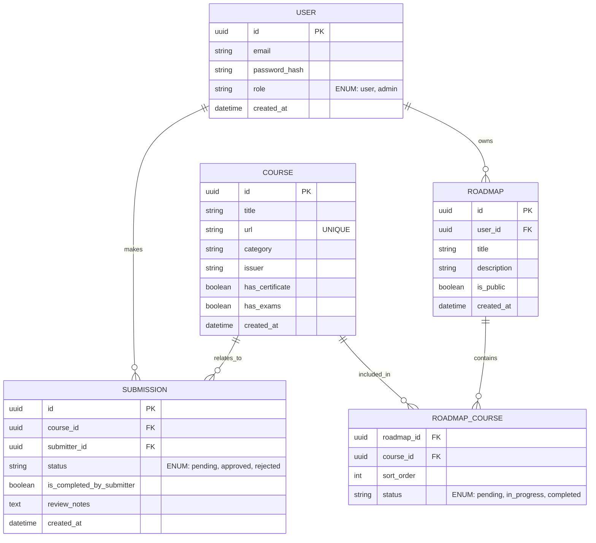
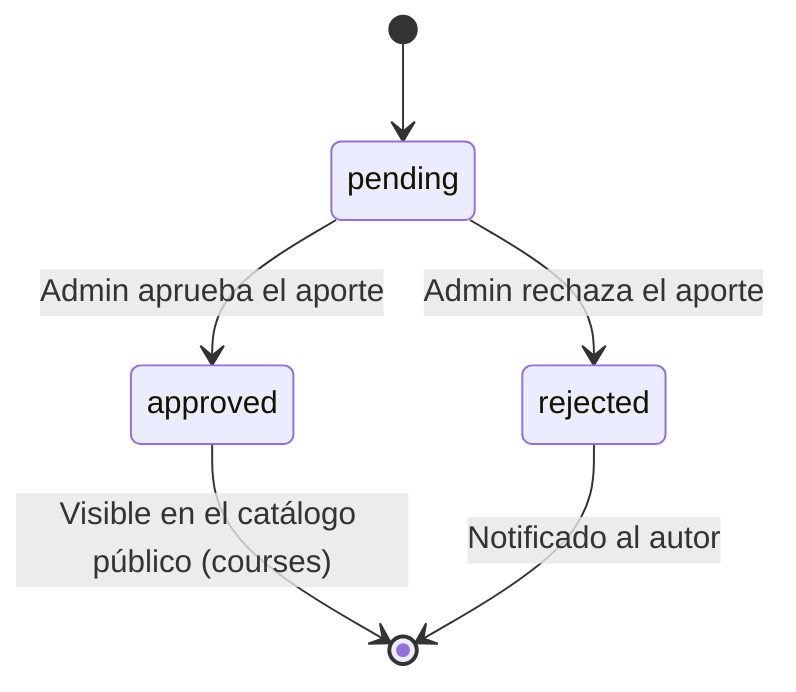

g# BackendSchema — Esquema de base de datos y APIs — [Nombre del producto]

> **Qué es:** el contrato del backend: modelo de datos en PostgreSQL + superficie de API REST.
> Es lo que hace posible el TRD y lo que consume el APPFlow.
> **Cuándo está bien:** con este documento se puede crear la base de datos y escribir los tests
> de integración sin tomar decisiones de diseño pendientes; todo endpoint que aparece en el
> APPFlow existe acá con sus respuestas y errores; los estados del curso están modelados.

## 1. Modelo de datos

### 1.1 Diagrama entidad-relación (Mermaid — se renderiza en GitHub)

### 1.2 Tablas (una por entidad)

#### `users`

| Columna | Tipo | Constraints | Notas |
|---------|------|-------------|-------|
| `id` | uuid | PK | Identificador único del usuario |
| `email` | varchar(255) | UNIQUE NOT NULL | Email de acceso |
| `password_hash` | varchar | NOT NULL | Hash encriptado de la contraseña |
| `role` | varchar(50) | DEFAULT 'user' | Rol del usuario (`user`, `admin`) |

**Índices:** `CREATE INDEX idx_users_email ON users(email)`; (Acelera la búsqueda durante el login).

#### `courses`

| Columna | Tipo | Constraints | Notas |
|---------|------|-------------|-------|
| `id` | uuid | PK | Identificador único del curso |
| `title` | varchar(150) | NOT NULL | Nombre del curso |
| `url` | varchar | UNIQUE, NOT NULL | Enlace al recurso externo |
| `category` | varchar(100) | NOT NULL | Ej: `frontend`, `backend`,`devops`. |
| `issuer`| varchar(100) | NOT NULL | Insitución o disertante creador.|

**Índices:** `CREATE INDEX idx_courses_category ON courses(category)`; (Optimiza los filtros del catálogo).

#### `submissions`

| Columna | Tipo | Constraints | Notas |
|---------|------|-------------|-------|
| `id` | uuid | PK | Identificador único de la solicitud |
| `status` | varchar(50) | DEFAULT 'pending' | `pending`, `approved`, `rejected` |
| `completed_by_submitter` | boolean | NOT NULL | (BR-002/BR-003) |

**Índices:** `CREATE INDEX idx_submissions_status ON submissions(status)`; (Optimiza la carga del panel admin)

#### Tabla: `roadmaps` y `roadmap_courses` (Ruta de aprendizaje)

- `roadmaps.is_public`: boolean (DEFAULT FALSE). Define si es visible para terceros
- `roadmap_courses`: tabla pivot con clave primaria compuesta (roadmap_id, course_id). Incluye columna `sort_order` para el drag&drop y `status` para medir el avance en esa ruta

## 2. Estados del ciclo de vida del curso

| Estado | Quién lo ve | Qué puede pasar |
|--------|-------------|-----------------|
| pending | Autor + Rol Admin | El administrador revisa para aprobar o rechazar |
| approved | Todos (Público) | El curso es insertado en el catálogo y se puede agregar a roadmaps. |
| rejected | Autor + Rol Admin | Se visualiza el motivo del rechazo en base al feedback del admin. |

## 3. API REST

**Convención general:**

- Prefijo: `/api/v1`
- Paginación: offset — `limit=20&offset=0` con respuesta `{ "items": [...], "total": N, "limit": n, "offset": n }`
- Errores: Formato RFC 7807 (Problem Details) — `{ "type": "...", "title": "...", "status": 400, "detail": "..." }`
- Timestamps en ISO 8601 UTC

### 3.1 Autenticación

| Método | Path | Auth | Request | Respuestas |
|--------|------|------|---------|------------|
| POST | `/api/v1/auth/registro` | pública | `{ "email": "...", "password": "...", "nombre": "..." }` | 201 `{…}` · 409 email duplicado · 422 validación |
| POST | `/api/v1/auth/login` | pública | `{ "email": "...", "password": "..." }` | 200 token/sesión · 401 credenciales |
| POST | `/api/v1/auth/logout` | sesión | — | 204 |

### 3.2 Catálogo de cursos

| Método | Path | Auth | Query / Request | Respuestas |
|--------|------|------|-----------------|------------|
| GET | `/api/v1/courses` | pública | `page`, `page_size`, `categoria`, `q` | 200 paginado · 422 |
| GET | `/api/v1/courses/{id}` | pública | — | 200 · 404 |
| GET | `/api/v1/courses/check-url` | pública | `?url=...` | 200 |

### 3.3 Aportes de cursos y validación

| Método | Path | Auth | Request | Respuestas |
|--------|------|------|---------|------------|
| GET |	`/api/v1/submissions`	| sesión | `limit, offset` | 200 paginado de roadmaps del usuario |
| GET | `/api/v1/submissions` |	admin | `?status=pending` | 200 lista paginada de aportes |
| POST | `/api/v1/submissions/{id}/approve` | admin | - | 200 OK · 403 · 404 |
|POST | `/api/v1/submissions/{id}/reject` | admin | `{ "reason": "..." }` | 200 OK · 403 · 404 |

### 3.4 Roadmap del usuario

| Método | Path | Auth | Request | Respuestas |
|--------|------|------|---------|------------|
| GET |	`/api/v1/roadmaps/me`	| sesión | `limit, offset` | 200 paginado de roadmaps del usuario |
| POST | `/api/v1/roadmaps` |	sesión | `{ "title": "...", "is_public": false }` | 201 creado |
| PATCH | `/api/v1/roadmaps/{id}/visibility` | sesión | `{ "is_public": true }` | 200 OK · 403 (no owner) · 404 |
|POST | `/api/v1/roadmaps/{id}/courses` | sesión | `{ "course_id": "uuid..." }` | 201 OK · 409 ya incluido · 404 curso o roadmap inexistente |
| PUT | `/api/v1/roadmaps/{id}/reorder` | sesión | `[{ "course_id": "uuid", "sort_order": 1 }, ...]` | 200 OK |

## 4. Decisiones del esquema

| Decisión | Alternativas | Por qué |
|----------|--------------|---------|
| Identificadores UUID en PostgreSQL | Enteros Auto-incrementales (Serial) | Los UUID (v4) evitan la predicción de volúmenes de cursos/usuarios (seguridad) y son estándar para integraciones distribuidas, soportados nativamente por Postgres. |
| Tabla intermedia `roadmap_courses` | Array de JSONB dentro del registro del Roadmap | La tabla relacional intermedia permite tener el campo `sort_order` para el drag and drop del frontend, y el campo `status` para evaluar el avance (pendiente/en curso/completado) de forma atómica e indexable. |
| Estandarización de Errores RFC 7807 | Envelope JSON custom (ej. `{ success: false }`) | FastAPI facilita interceptar excepciones a nivel global. Enviando respuestas tipo `Problem Details` el cliente React puede mapear los errores a los Toasts o modales de forma predecible sin evaluar estructuras distintas por endpoint. |

---

**Referencias:**
- Mermaid — Entity Relationship Diagrams: https://mermaid.js.org/syntax/entityRelationshipDiagram.html
- PostgreSQL — The Conceptual Model (tablas, constraints, índices): https://www.postgresql.org/docs/current/datamodel.html
