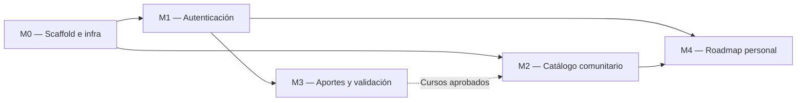

# Implementation Plan — [Nombre del producto]

> **Qué es:** el orden de construcción. Módulos, dependencias, tareas con su definición de hecho
> y estimaciones. Es lo que ejecutás en la Instancia B, tarea por tarea, rama por rama.
> **Cuándo está bien:** cada tarea tiene un "hecho" verificable sin interpretaciones; el orden
> respeta dependencias reales; el MVP está definido sin ambigüedades — se puede responder
> con un sí o un no a la pregunta "¿el lunes a la noche funciona esto?".

## 1. MVP — qué es P0

> Criterio de MVP: en una máquina limpia, `docker compose up` y recorrer end-to-end las
> siguientes historias del PRD, sin errores en consola:

- **US-001:** Como visitante, quiero ver el catálogo comunitario paginado, para descubrir cursos sin registrarme.
- **US-002:** Como usuario registrado, quiero aportar un curso con sus metadatos, para enriquecer el catálogo comunitario.
- **US-003:** Como usuario autenticado, quiero crear un roadmap personal de aprendizaje combinando cursos del catálogo, para estructurar mi propia ruta de formación.
- **US-004:** Como usuario, quiero aplicar filtros cruzados en el catálogo, para encontrar exactamente lo que busco.

## 2. Módulos y dependencias (mínimo 4)

> [Ajustá el grafo a tu PRD y tu TRD. Las flechas son dependencias reales:
> no podés probar el catálogo sin el scaffold, no podés aportar sin sesión, etc.]

## 3. Detalle por módulo

### M0 — Scaffold e infraestructura

| # | Tarea | Hecho cuando… | Estimación |
|---|-------|----------------|------------|
| 0.1 | Estructura de carpetas del TRD §3.2 | el árbol existe en el repo, vacío pero correcto | 30 min |
| 0.2 | `docker-compose.yml` con postgres 18.6 | `docker compose up postgres` levanta y acepta conexiones | 45 min |
| 0.3 | Backend FastAPI mínimo con `GET /health` | `curl localhost:8000/health` responde 200 | 1 h |
| 0.4 | Frontend Vite + React 19 con shell (header + router) | `pnpm dev` muestra el shell navegable | 1 h |
| 0.5 | Setup ORM (SQLAlchemy) e inicialización | Tablas relacionales mapeadas y creadas en PostgreSQL según el BackendSchema | 1.5 h |

### M1 — Autenticación

| # | Tarea | Hecho cuando… | Estimación |
|---|-------|----------------|------------|
| 1.1 | Endpoints `POST /registro` y `POST /login` | La API valida contraseñas hasheadas y devuelve un token JWT válido. | 2 h |
|1.2 | Middleware de JWT en Backend | Las rutas protegidas retornan un error RFC 7807 de Status 401 si no hay token | 1 h |
|1.3 | Pantallas de UI (Login / Registro) | El usuario puede loguearse y el JWT queda guardado en Context/LocalStorage | 2 h |
| 1.4 | Interceptor HTTP Frontend (Axios/Fetch) | Toda petición al backend adjunta automáticamente el header `Authorization: Bearer <token>` | 1 h |

### M2 — Catálogo comunitario

| # | Tarea | Hecho cuando… | Estimación |
|---|-------|----------------|------------|
| 2.1 | Seed (Poblado de datos iniciales) | La BD arranca con categorías base y al menos 5 cursos de prueba aprobados | 1h |
| 2.2 | `GET /api/v1/courses` paginado y filtrado | API responde 200 con `items`, `total`, `offset` respetando filtros (categoría) | 2.5h |
| 2.3 | Pantalla UI: Catálogo | Se ven las cards renderizadas, el empty state y el paginador funcional | 3h |
| 2.4 | Detalle de curso `GET /api/v1/courses/:id` | Se carga la vista completa de 1 curso específico con su temario y reseñas | 1.5h |

### M3 — Aportes y ciclo de validación

| # | Tarea | Hecho cuando… | Estimación |
|---|-------|----------------|------------|
| 3.1 | Formulario UI: Aportar Curso | alida campos obligatorios y reglas visualmente; muestra spinner de carga. | 2h |
| 3.2 | `POST /api/v1/submissions` | El backend persiste el curso en la BD con estado pending | 1.5h |
| 3.3 | UI: Panel Admin de moderación | Un usuario administrador puede ver la cola de aportes en la ruta `/admin` | 2h |
| 3.4 | Backend: Aprobar aporte | La API cambia el estado a `approved` y el curso empieza a aparecer en el Catálogo | 1.5h |

### M4 — Roadmap personal

| # | Tarea | Hecho cuando… | Estimación |
|---|-------|----------------|------------|
| 4.1 | CRUD de Roadmaps (Backend) | API expone endpoints para listar y crear hojas de ruta propias al usuario autenticado. | 2h |
| 4.2 | Agregar curso a Roadmap (Backend + UI) | El CTA "Agregar a mi roadmap" inserta en tabla pivot `roadmap_courses` sin errores | 2h |
| 4.3 | Vista UI: Mis Roadmaps | Muestra el progreso de aprendizaje y permite alternar estado Público/Privado | 3h |
| 4.4 | Reordenamiento (Drag & Drop UI) | El usuario puede arrastrar cursos para reordenarlos, y se guarda el `sort_order` en DB | 2.5h |

## 4. Ejecución (Instancia B)

> **Regla:** 1 tarea (o lote coherente) = rama según tu flujo documentado + Commits convencionales.
> Actualizá esta tabla mientras avanzás.

| # | Tarea | Módulo | Estado | Rama / Commit |
|---|-------|--------|--------|---------------|
| 0.1 | Estructura de carpetas | M0 | [ ] | `chore/repo-setup` |
| 0.2 | docker-compose postgres | M0 | [ ] | `docker/db-setup` |
| 0.3 | Backend FastAPI mínimo | M0 | [ ] | `feat/backend-health` |
| 0.4 | Frontend Vite + React shell | M0 | [ ] | `feat/frontend-shell` |
| 1.1 | Endpoints auth | M1 | [ ] | `feat/auth-jwt` |

## 5. Estrategia de testing

> Se **planificá** acá y se **implementa** en la clase del 27/10.

- **Unit tests (services):** funciones puras de negocio — ej. reglas de validación de aportes,
  reglas del roadmap, transiciones de estado del curso. Patrón AAA, sin BD ni HTTP.
- **Integration tests (repositories/services):** contra BD real (SQLite en memoria o Postgres del compose).
- **Frontend:** hooks con Vitest (estado de carga, paginación, errores).
- Objetivo de cobertura: ≥ 80% de cobertura (coverage) en los módulos lógicos (Services de FastAPI).

## 6. Riesgos del plan

| Riesgo | Impacto | Mitigación |
|--------|---------|------------|
| El formulario de aporte requiere validación en tiempo real para evitar duplicados | Medio (Retraso M3) | Implementar validación tipo debounce en React hacia el endpoint de verificación y usar schemas robustos de Pydantic. |
| Complejidad en el Drag & Drop de la tabla de roadmaps. | Medio (Retraso M4) | Uso de librería comprobada (ej. dnd-kit), y aislar el desarrollo al final (Nice-to-have sobre funcionalidad core). | 
| Tokens JWT que expiran y bloquean la navegación abruptamente causando mala UX. | Alto (Experiencia) | Implementar Interceptor Axios para manejar el error 401 unificado y redirigir al login limpiamente, persistiendo la ruta original. |

---

**Referencias:**
- Atlassian — Plantilla de plan de proyecto: https://www.atlassian.com/software/confluence/templates/project-plan
- Shape Up — cómo partir trabajo real en scopes cerrables: https://basecamp.com/shapeup/
