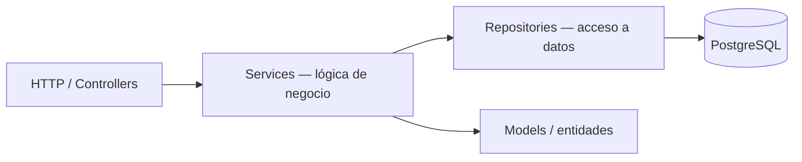
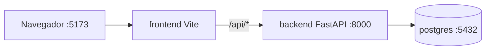

# TRD — Technical Requirements Document — CommunityCoursesIT

> **Qué es:** el CÓMO técnico. Decisiones de arquitectura, stack, estructura de carpetas y
> convenciones. No es el plan de tareas (eso es el IMPLEMENTATION_PLAN) ni el producto (PRD).
> **Cuándo está bien:** un developer que no estuvo en la charla puede levantar el proyecto y
> tomar las mismas decisiones que vos; cada decisión importante tiene alternativas, la opción
> elegida y el porqué.

## 1. Stack y versiones exactas

| Capa | Elección | Versión exacta | Por qué |
|------|----------|----------------|---------|
| Frontend | React + Vite + pnpm | React 19.x, Vite, pnpm | Interfaz de usuario declarativa basada en componentes y compilación ultrarrápida |
| Backend | FastAPI + uv | FastAPI, Python (uv) | Rendimiento asíncrono nativo, tipado estricto y generación automática de contratos OpenAPI |
| ORM / driver | SQLAlchemy / Psycopg | SQLAlchemy v2.x | Mapeo objeto-relacional robusto y maduro para Python y PostgreSQL |
| BD | PostgreSQL | 18.6 | Fijado por la SPEC de clase como motor relacional principal |
| Infra (dev) | Docker + Compose | Docker Engine v2+ | Aislamiento y estandarización del entorno de desarrollo local |

## 2. Decisiones técnicas (mínimo 3)

| # | Decisión | Alternativas consideradas | Elegida | Por qué |
|---|----------|---------------------------|---------|---------|
| TD-001 | Estrategia de autenticación | JWT stateless / Sesión server-side / OAuth externo | JWT (JSON Web Tokens) | Permite una arquitectura desacoplada SPA + API REST sin mantener estado de sesión en el servidor. |
| TD-002 | Estrategia de paginación | Offset + total / Cursor-based | Offset + limit | Simplicidad de implementación tanto en los endpoints de FastAPI como en los componentes de interfaz de usuario de React para el volumen esperado. |
| TD-003 | Formato de errores de API | Envelope propio / RFC 7807 (problem+json) | RFC 7807 (Problem Details) | Estandariza la estructura de los errores HTTP devueltos por el backend, facilitando el manejo de excepciones en el frontend. |
| TD-004 | Modelado de roadmaps personales | Tabla intermedia con estado / Referencia directa | Tabla relacional intermedia con orden de ítems | Permite que un roadmap contenga múltiples cursos ordenados de forma flexible y personalizada por el usuario. |

## 3. Arquitectura

### 3.1 Patrón y capas

Screaming Architecture + arquitectura en capas:



- **Controllers:** reciben HTTP, validan input, delegan. Sin lógica de negocio.
- **Services:** reglas de negocio puras y testeables (sin BD, sin HTTP).
- **Repositories:** única puerta a la BD. Sin reglas de negocio.
- **La estructura de carpetas habla del dominio**, no del framework.

### 3.2 Estructura de carpetas (la que se va a crear en la Instancia B)

```
tu-repo/
├── backend/
│   ├── pyproject.toml
│   ├── Dockerfile
│   ├── app/
│   │   ├── main.py
│   │   ├── config.py
│   │   ├── [feature_o_dominio]/        # ej. cursos/, aportes/, roadmap/, identidad/
│   │   │   ├── router.py               # endpoints de esa feature
│   │   │   ├── service.py              # reglas de negocio
│   │   │   ├── repository.py           # acceso a datos
│   │   │   └── models.py               # entidades / schemas
│   │   └── ...
│   └── tests/
├── frontend/
│   ├── package.json
│   ├── Dockerfile
│   └── src/
│       ├── main.jsx
│       ├── app/                        # shell, router, layout global
│       ├── features/                   # ej. catalogo/, aportar/, roadmap/
│       │   └── [feature]/
│       │       ├── components/
│       │       ├── hooks/
│       │       └── api.js
│       └── styles/                     # tokens globales (de UX-UI)
├── docker-compose.yml
└── docs/
```

### 3.3 Servicios Docker (entorno de desarrollo)

| Servicio | Imagen/base | Puerto | Rol |
|----------|-------------|--------|-----|
| postgres | postgres:18.6 | 5432 | base de datos |
| backend | python:3.x-slim + uv | 8000 | API FastAPI (dev) |
| frontend | node:20-alpine + pnpm | 5173 | SPA Vite (dev server) |



> En la clase del 27/10 estos Dockerfiles evolucionan a multi-stage. Por ahora, lo mínimo que levanta.

## 4. Convenciones

- **Commits:** Conventional Commits — `feat:`, `fix:`, `docs:`, `test:`, `refactor:`, `chore:`, `docker:`
- **Flujo de Git:** Se utiliza GitHub Flow con ramas de características (docs/..., feat/...), commits atómicos y fusiones explícitas mediante git merge --no-ff hacia main.
- **Errores de API:** Formato estándar basado en RFC 7807 `({ "type": "...", "title": "...", "status": 400, "detail": "..." })`
- **Variables de entorno:**

  | Variable | Ejemplo | Obligatoria | Descripción |
  |----------|---------|-------------|-------------|
  | DATABASE_URL | postgresql://…@postgres:5432/… | sí | URI de conexión a PostgreSQL |
  | SECRET_KEY | super_secret_jwt_key_123 | sí | Clave para firmado de tokens JWT |
   |

- **Logging y excepciones:** Se utiliza logging estructurado a nivel de aplicación en FastAPI; las excepciones no controladas son interceptadas por un middleware global que retorna respuestas HTTP normalizadas.

## 5. Requisitos no funcionales técnicos (traducción de las restricciones)

| Restricción (SPEC) | Cómo se cumple | Dónde se verifica |
|--------------------|----------------|-------------------|
| Paginación de listados | Parámetros limit y offset validados en esquemas Pydantic y aplicados en repositorios | `GET /api/v1/courses?limit=20&offset=0` |
| Mobile-first con mejora progresiva | Estilos base limpios sin media queries complejas; `@media (min-width)` exclusivo para expansión | Componentes de grilla y navegación |
| Menú sándwich | Componente Header colapsable con accesibilidad ARIA para dispositivos móviles | `APPFlow §3` y componentes UI |
| Screaming Architecture | Organización de carpetas backend y frontend orientada al dominio de negocio (courses/, roadmaps/) | Revisión de estructura del repositorio |

## 6. Riesgos técnicos

| Riesgo | Probabilidad | Impacto | Mitigación |
|--------|--------------|---------|------------|
| Inconsistencia en los datos aportados por usuarios externos (URLs rotas o malformadas) | Media | Medio | Validación estricta de formatos de URL mediante Pydantic y revisión humana obligatoria en el flujo de validación (BR-001). |

---

**Referencia:**
- Design Docs at Google (el clásico de los design docs, con énfasis en trade-offs):
  https://www.industrialempathy.com/posts/design-docs-at-google/
